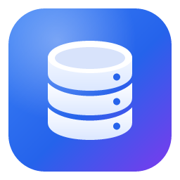

<div align="center">



# DB Client

**A fast, modern desktop client for PostgreSQL and MySQL.**
Built with Rust and Tauri — small, native and quick to start.

[Website](https://madnesscode.github.io/dbclient/) · [Download](https://github.com/MadnessCODE/dbclient/releases/latest)


</div>

> [!WARNING]
> **DB Client is in beta.** It is used daily during development, but expect rough edges and breaking changes.
> Be careful on production databases and please [report issues](https://github.com/MadnessCODE/dbclient/issues).

## Features

**Connections**
- PostgreSQL and MySQL / MariaDB, with SSL and **SSH tunnels** (password or key, host key verification)
- Passwords stored in the system keychain (Windows Credential Manager, macOS Keychain, Linux Secret Service)
- Projects to group connections, colors and environment labels (DEV / STAGING / PROD)
- **Production guard**: statements that change data ask for confirmation on PROD connections
- Import connections from DBeaver, pgAdmin 4, MySQL Workbench, Sequel Ace / Sequel Pro and `.pgpass`, including saved passwords where the tool allows it

**Querying**
- SQL editor (Monaco) with autocomplete for tables, columns and aliases
- Run the statement under the cursor, a selection or the whole script; cancel long queries
- Results grid that stays fast with large results, sorting, NULL clearly shown, foreign-key links to related rows
- Per-tab history and EXPLAIN

**Editing data**
- Edit cells inline, multi-select and set many cells at once, add / duplicate / delete rows
- Date & time picker (time zones, PostgreSQL ±infinity), enum/set pickers, JSON viewer
- All changes are previewed as SQL and saved in one transaction

**Schema**
- Schema tree with search, table sizes and right-click actions
- Structure editor: columns, indexes, foreign keys, with ALTER preview
- ER diagrams: right-click a schema → ER diagram; drag tables around, then export a single HTML file with the diagram and full table documentation

**Import & export**
- Export to CSV, Excel (real .xlsx), JSON and SQL INSERT — including all rows from the database, not just the loaded page
- Import SQL dumps (mysqldump, pg_dump plain, `.sql.gz`) **in parallel** over several connections
- Export a whole database or schema to `.sql` / `.sql.gz` **in parallel** from one consistent snapshot — about 4–5× faster than pg_dump / mysqldump
- Import CSV, Excel and JSON into a new or existing table, with type detection and column mapping
- Long jobs run in the background with progress, notifications and a task list

**Administration**
- Users & privileges: create users/roles, passwords, database / schema / table / view level grants, quick presets
- Processes: live list of sessions and running queries, lock waits (who blocks whom), cancel a query or kill a connection

## Download

Get the installer from the [latest release](https://github.com/MadnessCODE/dbclient/releases/latest) or the [website](https://madnesscode.github.io/dbclient/). The app updates itself when a new version is out.

- **Windows 10 / 11:** `x64-setup.exe` for most PCs, `arm64-setup.exe` for Windows on ARM. Installs for the current user, no admin rights needed.
- **macOS 11+:** `universal.dmg` runs on Apple Silicon and Intel Macs.
- **Linux (x64 / ARM64):** `.AppImage` runs on most distributions and updates itself (`chmod +x`, then run it); `.deb` for Ubuntu / Debian, `.rpm` for Fedora / openSUSE.

The installers aren't code-signed yet:
- **Windows:** if SmartScreen shows a warning, click **More info** → **Run anyway**.
- **macOS:** the first launch is blocked; go to **System Settings → Privacy & Security** and click **Open Anyway**.

On other platforms, build from source (below).

## Build from source

Requirements:
- [Rust](https://rustup.rs/) (stable)
- [Node.js](https://nodejs.org/) 20 or newer
- Tauri system dependencies for your OS — see [Tauri prerequisites](https://tauri.app/start/prerequisites/)

```bash
git clone https://github.com/MadnessCODE/dbclient.git
cd dbclient
npm install
npm run tauri dev     # run in development mode
npm run tauri build   # build an installer for your platform
```

## Tech stack

- **Backend:** Rust, [Tauri 2](https://tauri.app/), [sqlx](https://github.com/launchbadge/sqlx), [russh](https://github.com/Eugeny/russh)
- **Frontend:** React 19, TypeScript, Tailwind CSS, Monaco Editor, Zustand

## Contributing

Bug reports and ideas are welcome — open an [issue](https://github.com/MadnessCODE/dbclient/issues).
Pull requests too; for bigger changes please open an issue first so we can talk about it.

## License

[MIT](LICENSE) © 2026 [MadnessCODE](https://github.com/madnesscode)
